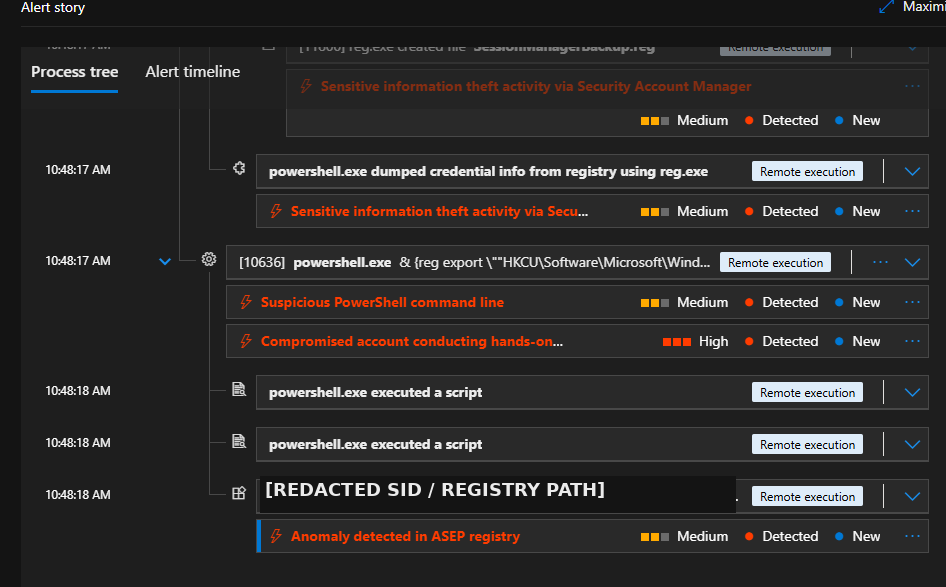
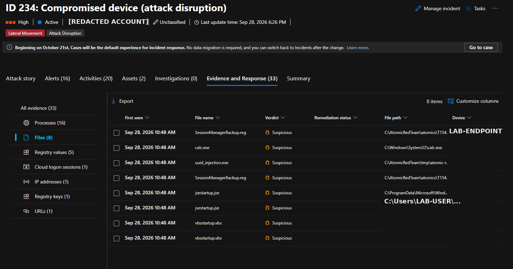
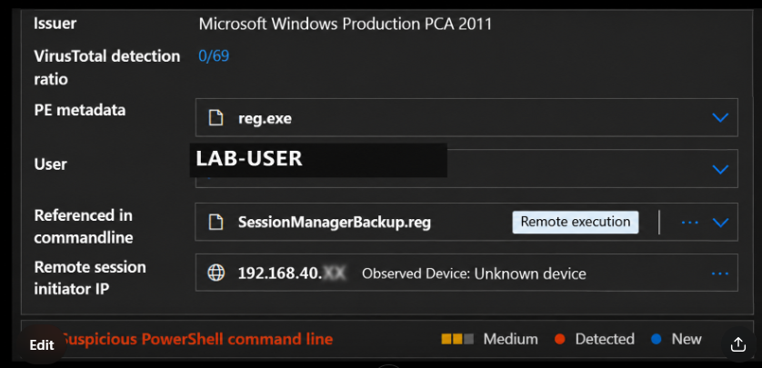
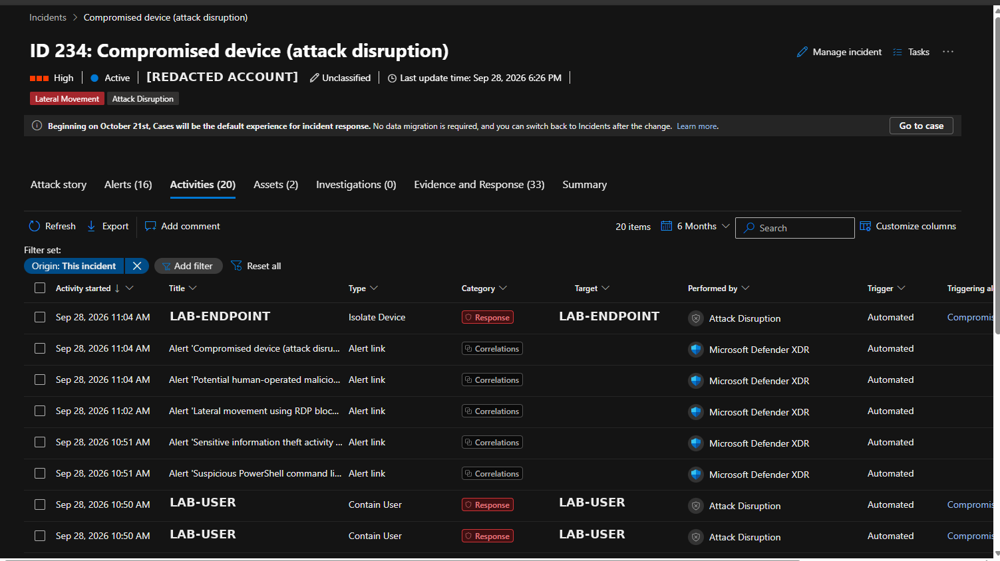
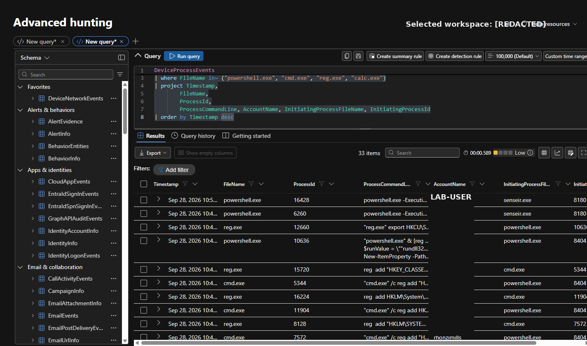

# Microsoft Defender XDR – Atomic Red Team Investigation

## Project Overview

This project documents an authorized Atomic Red Team security simulation investigated in Microsoft Defender XDR. The exercise generated attacker-like endpoint behavior that Defender correlated into **Incident 234 – Compromised device (attack disruption)**.

The investigation focused on using the **Attack Story, process tree, Evidence and Response, and targeted Advanced Hunting** to quickly identify the important activity instead of reviewing every telemetry event individually.

> **Lab Notice:** This was an authorized cybersecurity simulation conducted in a controlled lab environment. Sensitive usernames, device names, tenant/workspace identifiers, SIDs, and private IP addresses were sanitized before publication.

---

## Incident Summary

- **Platform:** Microsoft Defender XDR
- **Severity:** High
- **Correlated Alerts:** 16
- **Evidence / Response Objects:** 33
- **Affected Assets:** 2
- **Primary Technique:** MITRE ATT&CK T1547.001 – Registry Run Keys / Startup Folder
- **Verdict:** True Positive – Authorized Security Simulation

---


### Incident & Attack Story Evidence

The Defender incident view correlated the simulated activity into a high-severity incident and provided the attack story used for initial triage.

.png)

---

## Investigation Timeline

| Time shown in Defender | Activity |
|---|---|
| 09:56:45 AM | First activity recorded in the incident |
| 10:48:09 AM | PowerShell/startup-related activity; `vbsstartup.vbs` observed |
| 10:48:10 AM | Additional startup-related activity including `jsestartup.jse` |
| 10:48:12 AM | `cmd.exe` registry-related activity |
| 10:48:14–10:48:18 AM | Concentrated PowerShell → cmd.exe/reg.exe activity and registry operations |
| ~10:50 AM | Defender Attack Disruption contained the affected user |
| 10:55:44 AM | RDP Session ID 4 stopped/disconnected; lateral-movement alert correlated |
| ~11:04 AM | Defender Attack Disruption isolated the endpoint |
| After containment | Targeted Advanced Hunting used to validate process/account relationships |

*Times are preserved as displayed in Microsoft Defender XDR and were not independently converted to UTC.*

---

## Investigation Workflow

1. Triaged the high-severity incident.
2. Reviewed the Defender Attack Story.
3. Examined correlated alerts and affected assets.
4. Analyzed the process tree.
5. Reviewed Evidence and Response artifacts.
6. Investigated PowerShell, `cmd.exe`, and `reg.exe` activity.
7. Reviewed persistence-related registry and startup artifacts.
8. Validated remote-session evidence.
9. Used targeted Advanced Hunting to validate important findings.
10. Reviewed automated Attack Disruption actions.
11. Determined the final verdict.

---

## Key Findings

The investigation identified PowerShell and command-shell execution, registry modification through `reg.exe`, startup/persistence-related artifacts, remote-session telemetry, file activity, automated user containment, RDP disruption, and endpoint isolation.

Notable artifacts included `SessionManagerBackup.reg`, `vbsstartup.vbs`, `jsestartup.jse`, and `uuid_injection.exe`.

Process relationships and command-line evidence were consistent with the authorized Atomic Red Team exercise.

The investigation identified PowerShell and command-shell execution, registry modification through `reg.exe`, startup/persistence-related artifacts, remote-session telemetry, file activity, automated user containment, RDP disruption, and endpoint isolation.

Notable artifacts included `SessionManagerBackup.reg`, `vbsstartup.vbs`, `jsestartup.jse`, and `uuid_injection.exe`.

Process relationships and command-line evidence were consistent with the authorized Atomic Red Team exercise.

### Process Tree Evidence

The Defender process tree was used to identify parent-child process relationships and focus the investigation on relevant PowerShell, command-shell, and registry activity.



### File and Registry Evidence

Evidence and Response was reviewed for artifacts associated with the simulated activity, including registry-related files and command-line references.




### Remote Session Evidence

Remote-session telemetry was reviewed during incident scoping. The initiating address was verified as belonging to the authorized lab environment. Sensitive addressing information has been sanitized for public portfolio use.



The Defender process tree was used to identify parent-child process relationships and focus the investigation on relevant PowerShell, command-shell, and registry activity.


### Attack Disruption Response

Microsoft Defender XDR performed automated response actions against the attacker-like behavior generated during the simulation, including containment and endpoint isolation.



---
## Advanced Hunting

Advanced Hunting was used as a **targeted validation step** rather than reviewing every endpoint event individually.

```kusto
DeviceProcessEvents
| where FileName in~ ("powershell.exe", "cmd.exe", "reg.exe", "calc.exe")
| project Timestamp,
          FileName,
          ProcessId,
          ProcessCommandLine,
          AccountName,
          InitiatingProcessFileName,
          InitiatingProcessId
| order by Timestamp desc
```

The query helped validate relevant command lines, process relationships, execution context, and associated accounts.

### Advanced Hunting Evidence

The hunting results were used to validate the process and account relationships identified during the Defender investigation.




---

## Analyst Assessment

**Verdict:** True Positive – Authorized Security Simulation

**MITRE ATT&CK:** T1547.001 – Registry Run Keys / Startup Folder

**Response:** User contained, RDP activity disrupted, and endpoint isolated.

Microsoft Defender XDR successfully detected and disrupted attacker-like behavior generated during the authorized Atomic Red Team simulation.

No conclusion of unauthorized external compromise was made from the evidence reviewed.

---

## Recommendations

1. Keep the lab endpoint isolated until the Atomic Red Team exercise and cleanup are complete.
2. Validate removal of persistence-related registry values, startup artifacts, and temporary test files.
3. Confirm that identified processes, files, registry activity, and remote-session details correspond to the authorized exercise; investigate anything unexplained.
4. Use targeted hunting for specific filenames, registry paths, users, command lines, and remote-session indicators rather than reviewing unrelated telemetry.
5. Document expected techniques, users, endpoints, execution windows, and artifacts before future simulations so authorized activity can be distinguished quickly from genuine compromise.

---

## Skills Demonstrated

- Microsoft Defender XDR
- Incident triage
- Attack Story analysis
- Process-tree analysis
- Endpoint investigation
- Advanced Hunting / KQL
- Registry persistence investigation
- MITRE ATT&CK mapping
- Incident scoping
- Attack Disruption analysis
- SOC investigation reporting

---

## Portfolio Report

A sanitized 7-page investigation report with supporting Defender screenshots accompanies this project. It documents the findings, detailed timeline, investigation summary, Who/What/When/Where/Why/How analysis, evidence, recommendations, and final analyst assessment.
